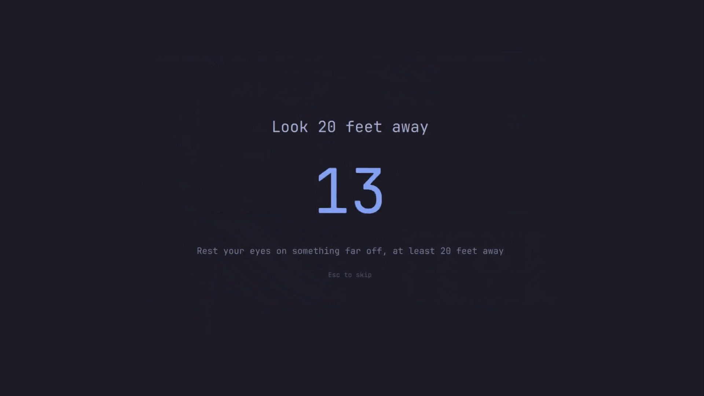

# Rest Reminder

A 20-20-20 eye break reminder for [Omarchy](https://omarchy.org/) 4.

Every 20 minutes of work, an opaque fullscreen screen covers every display for
20 seconds so your eyes can leave the screen. Both numbers are yours to change.
It runs inside the Omarchy shell as a plugin, not as another daemon, and it is
themed by whatever theme you are using.

It knows when not to interrupt: it stays out of the way while you are away from
the keyboard, while an app is holding an idle inhibitor, and while a window is
fullscreen.



## Install

```bash
omarchy plugin add https://github.com/camilolunacom/omarchy-restreminder.git --enable --yes
```

That places the countdown widget on the right of the bar and starts the timer.
Nothing else to configure. There are no dependencies beyond Omarchy itself:
everything runs inside `omarchy-shell`, and nothing is compiled or downloaded
at install time.

## Uninstall

```bash
omarchy plugin remove io.github.camilolunacom.restreminder
```

That takes the widget off the bar, stops the timer, and deletes the checkout.
The plugin writes exactly two things outside its own directory, both safe to
leave and both listed here so you can be sure:

- its entry in `~/.config/omarchy/shell.json`, which `omarchy plugin remove`
  takes with it
- `~/.local/state/omarchy/restreminder`, one line holding a timed pause, if you
  ever set one: `rm -f ~/.local/state/omarchy/restreminder`

It never edits any other part of your configuration.

## Settings

Settings are inline on the plugin's entry in `~/.config/omarchy/shell.json`,
which hot-reloads on save. The entry lives in `bar.layout.<section>` while the
widget is on the bar, and in `plugins[]` when it is not:

```json
{
  "id": "io.github.camilolunacom.restreminder",
  "workMinutes": 20,
  "breakSeconds": 20,
  "warningSeconds": 10,
  "breakHeadline": "Look 20 feet away",
  "breakMessage": "Rest your eyes on something far off, at least 20 feet away",
  "breakEndSound": true
}
```

| Key                | Default                                                       | What it does                                                      |
|--------------------|---------------------------------------------------------------|-------------------------------------------------------------------|
| `workMinutes`      | `20`                                                          | Minutes of work between breaks                                      |
| `breakSeconds`     | `20`                                                          | How long the break screen stays up                                  |
| `warningSeconds`   | `10`                                                          | Heads-up before the break; `0` turns it off                         |
| `idlePauseMinutes` | `workMinutes`                                                 | Time away from the keyboard that counts as having taken the break   |
| `breakHeadline`    | `Look 20 feet away`                                           | Big line on the break screen                                        |
| `breakMessage`     | `Rest your eyes on something far off, at least 20 feet away`  | Line under the countdown                                            |
| `breakEndSound`    | `true`                                                        | Ring when a break ends; `false` for silence                         |
| `breakEndSoundFile`| freedesktop `complete.oga`                                    | Which sound to ring                                                 |

Anything missing or malformed falls back to its default rather than breaking
the shell, and a blank string counts as missing. The two strings are yours to
reword, translate, or put in metres; changing them does not restart the
interval you were already serving, only the timing values do.

## Using it

- **Esc** during a break skips it and restarts the interval.
- **Click** the bar widget for a popup with the countdown to the second and
  three buttons: break now, skip, and pause. **Right click** pauses and resumes
  without opening it; **middle click** breaks now.
- The widget shows the countdown, or the reason there isn't one: `away`,
  `hold` (waiting for fullscreen to end), `break`, or a pause glyph — the same
  mark as the popup's Pause button, so the state and the control that caused
  it read as one thing.
- **Skip** means the same thing either side of a break starting: the next one
  is a full work interval away. During a break it ends the break; before one it
  drops the break that was coming. It is inert while paused or away, where
  nothing is owed.
- **Pause freezes the countdown; it does not restart it.** Resuming picks up
  where you left off, so a pause is "not now" rather than "give me another
  twenty minutes" — the strain you had already earned does not go away because
  you stepped out of the way of a break. Resuming with almost no time left
  gives you the warning lead back rather than dropping the break screen on you
  in the same instant.
- Being **away** from the keyboard is different, and does restart the
  interval: that one really was a break.
- **A sound plays when a break ends**, because by then you are doing what the
  break asked and looking somewhere else, and nothing on screen can tell you it
  is over. A break you skipped stays silent: you were looking at it.

The sound is played with `pw-play`, which comes with PipeWire and so is always
there on Omarchy. The default sound is not: it is the freedesktop theme's
`complete.oga`, from `sound-theme-freedesktop`, which a minimal install need
not have. If it is missing you get silence and one line in the log rather than
an error every twenty minutes — install the package, point `breakEndSoundFile`
at a file you do have, or set `breakEndSound` to `false`.

Everything is scriptable through the shell's IPC, which is what a Hyprland
keybinding would call:

```bash
omarchy-shell restreminder status      # JSON: state, countdown, why it is deferred
omarchy-shell restreminder breakNow
omarchy-shell restreminder skip
omarchy-shell restreminder pause 30    # timed; survives a shell restart
omarchy-shell restreminder pause ""    # indefinite; cleared by a restart
omarchy-shell restreminder resume

omarchy-shell restreminder-popup toggle    # the widget's popup
```

The pause argument is not optional at the IPC layer even though an indefinite
pause takes no duration: `omarchy-shell` rejects a call with fewer arguments
than the handler declares, so the indefinite form passes an empty string.

## When a break does not fire

- **You are away.** Idle past `idlePauseMinutes` suspends the timer; coming back
  starts a fresh interval, so a break never greets you at your desk.
- **An app is holding an idle inhibitor** and you are not typing. That reads as
  a video or a call, which a break screen would interrupt rather than rest.
- **A window is fullscreen.** The break waits, with no ceiling: a three-hour
  film defers for three hours and the break lands when it ends.

At most one break is ever owed, however long the wait was.

## Hacking on it

The plugin is a plain git checkout in `~/.config/omarchy/plugins/io.github.camilolunacom.restreminder/`.

```bash
omarchy plugin validate ~/.config/omarchy/plugins/io.github.camilolunacom.restreminder
omarchy restart shell
journalctl -t omarchy-shell -f | grep restreminder
```

Two things that cost time here, worth knowing before they cost you the same:

- **Editing through a symlink does not work.** The plugin scanner's watcher is
  `inotifywait -r`, which does not follow symlinks, and `omarchy plugin validate`
  refuses a symlinked plugin folder outright. Keep the checkout in the real
  plugin directory.
- **Saving a file reloads the plugin but can serve stale compiled QML.** The
  service is re-instantiated, yet the code it runs may be the previous version,
  which makes for very confusing debugging. `omarchy restart shell` is the
  reliable loop; `omarchy-shell restreminder status` is the fastest way to see
  what the running code actually thinks.

## Layout

| File                    | What it is                                                   |
|-------------------------|--------------------------------------------------------------|
| `Service.qml`           | Resident service: the timer, the deferral rules, the IPC     |
| `BreakOverlay.qml`      | The break screen and the pre-break warning                   |
| `BarWidget.qml`         | The countdown widget and its popup                           |
| `RestReminderModel.js`  | Pure helpers: settings parsing, label formatting             |
| `PRD.md`                | What this is meant to do, and why                            |

### Configuration compatibility

The service reads and watches `~/.config/omarchy/shell.json` directly. This
works with Omarchy's scoped `PluginShellApi`, which does not expose the host's
`shellConfig`. Valid edits apply without restarting the shell. Unreadable or
invalid JSON logs a warning and retains the last valid settings while the
service remains loaded (plugin defaults at startup). The host may itself unload
third-party plugins when its config is invalid; this reader cannot prevent
that. Settings still belong inline on the plugin entry shown above.

## License

[MIT](LICENSE).
